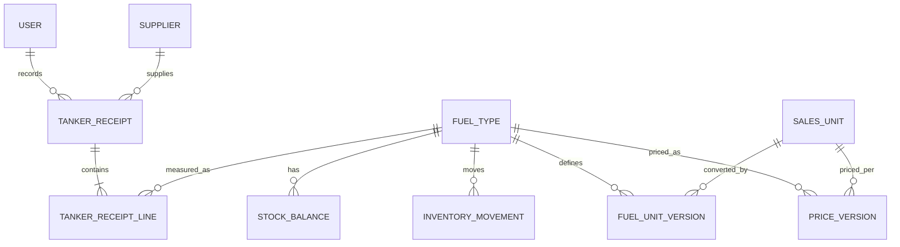
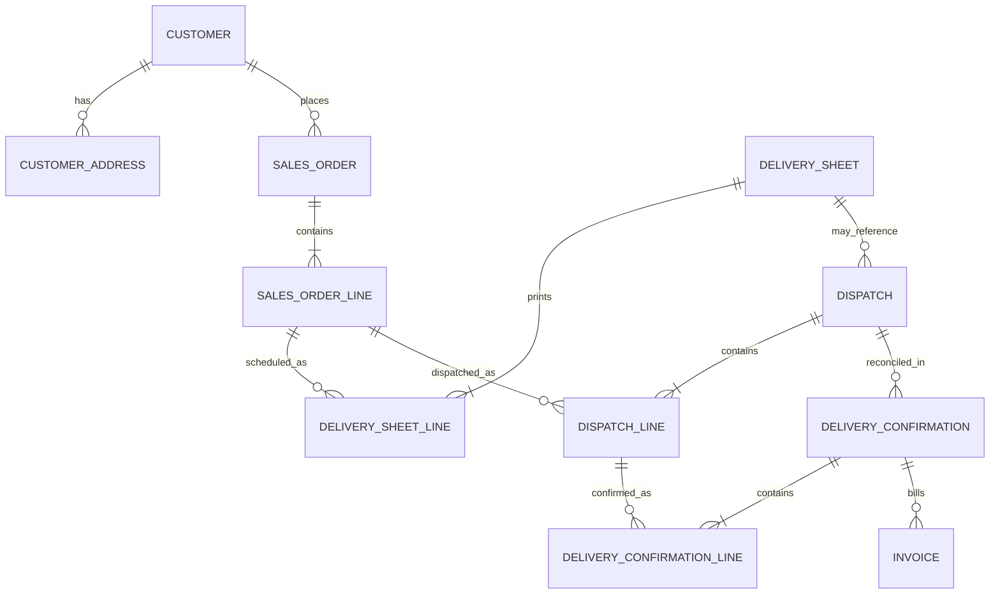
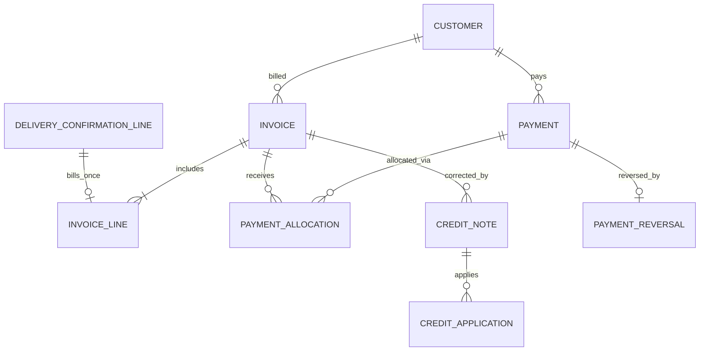

# Entity Relationship Diagrams (Mermaid)

Logical diagrams; source of truth for field constraints remains `database-design.md`. Cardinalities in partial-delivery domain allow 1:N events.

## Purchasing, products, inventory

## Customers, orders and non-driver delivery

## Finance

No `Driver`, `DeliveryStaff`, `VehicleOperator`, `DriverAssignment` or delivery-employee table in this MVP. A tanker/truck reference represents **incoming supply** only.
