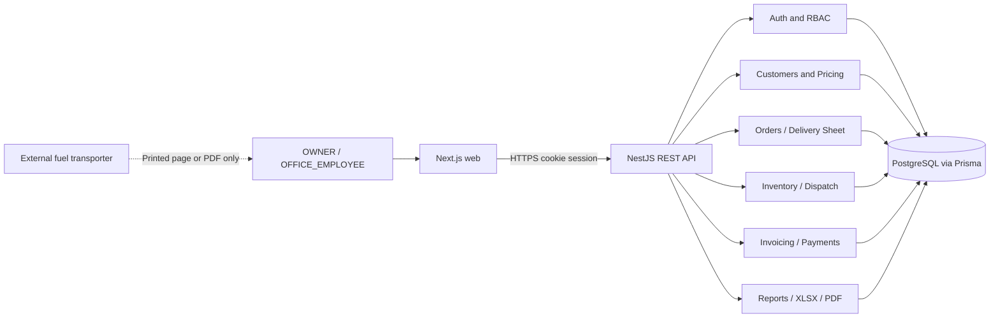

# System Architecture

## Design
Single-business **modular monolith**. The frontend calls a single NestJS REST API; PostgreSQL is the durable system of record. Modules are bounded by business responsibility, not microservices.



No external transporter interacts with API. No third role. No Redis/queues requirement in MVP.

## Repository layout
```
apps/
  web/                     # Next.js App Router frontend
    src/app/(auth)/login
    src/app/(dashboard)/dashboard
    src/app/(dashboard)/customers
    src/app/(dashboard)/orders
    src/app/(dashboard)/deliveries
    src/app/(dashboard)/stock
    src/app/(dashboard)/pricing
    src/app/(dashboard)/payments
    src/app/(dashboard)/invoices
    src/app/(dashboard)/reports
    src/app/(dashboard)/settings
  api/src/
    modules/auth/
    modules/users/
    modules/customers/
    modules/fuel-units/
    modules/tanker-receipts/
    modules/pricing/
    modules/inventory/
    modules/orders/
    modules/delivery-sheets/
    modules/dispatch/
    modules/delivery-reconciliation/
    modules/invoices/
    modules/payments/
    modules/reports/
    modules/audit/
  database/ or packages/database/ # single consistent placement selected at scaffold
packages/
  shared/                  # safe schemas/types (no secrets and no DB access)
```

**Canonical package placement:** Use `packages/database` (not `apps/database`); the indented schematic above means exactly that.

## Read models and write models
- Write APIs use transactions and normalized tables: order confirmation, physical dispatch, delivery accepted, invoice post, payment allocation, stock receive and reversals.
- Read APIs use paginated Prisma queries or SQL views; stock balance and customer balance may be materialized as transactional projections, always reconcilable from immutable journals.
- An export query must apply the *same* authorization filters and business logic as paginated reports; exports may stream page batches on large data.

## Transaction boundaries
- `postReceipt`: receipt state + warehouse movement + balance + audit atomically.
- `confirmOrder`: price+conversion snapshot + order status + audit atomically; lock price validity under concurrent updates.
- `postDispatch`: reserve release (if any) + warehouse decrement + transit increment + dispatch journal + audit atomically.
- `reconcileDelivery`: accepted/returned/in-transit movements + delivery event + ready-to-invoice record + audit atomically.
- `postInvoice`: unique billable event + invoice rows + receivable posting + audit atomically.
- `postPayment`: receipt + allocations + balances/customer credit + audit atomically.

## Consistency rules
- Idempotency keys on sensitive POSTs with `(actor-or-scope, endpoint, key)` uniqueness, request hash and persisted result reference.
- Enforce database uniqueness on external receipt references where applicable but *do not assume tanker labels globally unique*.
- Always use transaction-scoped row locks or compare-and-swap checks for stock, allocations and effective price changes; replay safe on retry.
- Store timestamps UTC, display `Africa/Mogadishu`. Business date filters must use explicit local-day->UTC boundaries.
- Strict DTO schemas; validation pipe; structured error codes; HTTP auth/permission/tenant-less resource scopes.
- One business, no tenant_id and no fabricated branches/multi-warehouse functionality.

## Performance and deployment
- Initial database PostgreSQL locally in Docker Compose; API and web can run using pnpm scripts. Separate production services with TLS, secure cookies, database migrations and backups.
- Paginate customer/order/payment/ledger lists; index by `(customerId, createdAt)`, `(fuelTypeId, createdAt)`, `(status, date)` as applicable.
- Reports produced server-side using ExcelJS/PDFKit; honor report row limits or batching and timeout policy.
- Operational logs must not include passwords, session tokens, customer-payment secrets or report/download raw contents.
